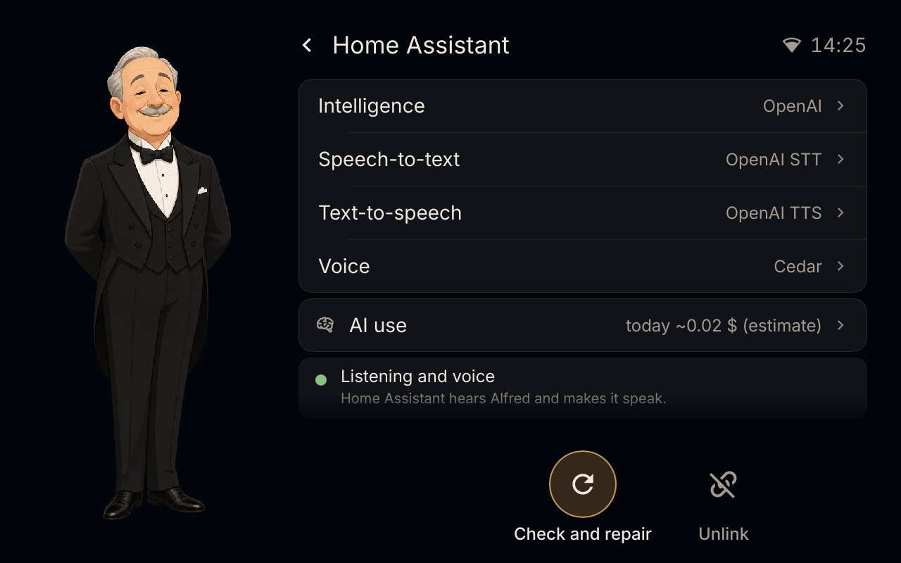

# 🎩 home-companion

A **lightweight voice companion for Home Assistant** that turns an old smart display into a desk assistant with
a face: a wake word heard on the device, an animated character on the screen, local timers and alarms, AirPlay
music and screen mirroring, and your Home Assistant dashboard one tap away. The thinking is done by **the AI you
already set up in Home Assistant** (Google Gemini, OpenAI, Anthropic, a local model): no API key on the device,
no cloud of ours.

The first device is the Lenovo ThinkSmart View (2 GB, a phone-class Snapdragon) running
[thinksmart-view-debian](https://github.com/m0s4ik/thinksmart-view-debian); the first character is **Alfred**, an
elderly butler.

<p align="center"></p>

[](https://github.com/m0s4ik/home-companion/releases)
[](https://www.home-assistant.io)
[](#install)
[](LICENSE)
[](https://buymeacoffee.com/m0s4ik)

If this project saved you some time, you can also
[buy me a coffee ☕](https://buymeacoffee.com/m0s4ik): it keeps the next one coming.

## What it does

### 🗣️ Talk to it

Say **"Okay Alfred"**: the wake word is heard on the device, and no audio leaves it before that. Your question
goes to Home Assistant's own voice pipeline (your speech-to-text, your AI agent, your voice) and Alfred answers on
the screen and out loud. "Stop" or "basta" interrupts him; after a question of his, a "no thanks" closes it.

<p align="center"></p>

**Reflexes**: the time, timers, alarms, the volume and the music ("what time is it", "set a timer for 10 minutes",
"next song") are understood **on the device** (Vosk with a closed grammar): instant, and they work with the Wi-Fi
down. Anything else goes to Home Assistant.

**Tools for your AI**: the device lends Home Assistant's agent its own tools over HA's built-in MCP client —
memories, reminders, the shopping list, timers and alarms, and the house **with safety gates** (covers and valves
only after a "yes"; locks, alarms, doors and gates never by voice).

### 🏠 The home screen

The clock, the date and Home Assistant's weather, and one card per thing that matters now: a due reminder, the
running timers, the next alarm, what AirPlay is playing, a mirrored screen to go back to. Below: **HA**, **Talk**
and **More** (memories, reminders, shopping, settings); a pull from the top edge opens the control centre (volume,
brightness, microphone, AirPlay, night). At night only the clock stays, dimmed;
the brightness follows the room's light.

### ⏱️ Timers, alarms and reminders, on the device

Timers and alarms live **on the device**: "set a timer for 10 minutes", "wake me up at 7", "how much time is left",
"cancel the timer" are reflexes, understood locally and done at once, and they ring even with the Wi-Fi or Home
Assistant down. Several timers at a time, pause and resume, alarms on chosen days; Home Assistant sees them as the
satellite's timers.

Reminders come from your AI ("remind me to call mum at five"): Alfred keeps them on the device and, when one is
due, shows it full screen with a chime until you tap OK, or say "stop", or put it off ten minutes.

<p align="center">


</p>

### 📊 Home Assistant on the screen

Your Home Assistant dashboard full screen, kept loaded in the background so it opens at once. The gold button, or
a swipe from its edge, brings you back to Alfred; "Okay Alfred" still works over it.

<p align="center">


</p>
<p align="center"><sub>A test Home Assistant with its demo devices.</sub></p>

### 🎵 AirPlay: music and screen mirroring

Pick the device in the AirPlay menu of an iPhone, an iPad or a Mac. **Music** shows its title and cover, can be
paused and skipped from the screen or by voice, and the phone's volume slider is the device's volume; the music
goes quiet while Alfred listens. **Screen mirroring** uses the hardware video decoder: upright, Alfred and the
controls stay at the sides; sideways, the picture fills the screen and the controls come with a tap.

<p align="center">


</p>

### 🔗 Set up from the screen

At the first start the screen asks the language, finds Home Assistant on the network and shows a QR code: open it
with a phone logged in to Home Assistant and the device sets itself up there — the Wyoming satellite, its tools
over MCP, Alfred's agent under your AI and his voice pipeline. Nothing to type, nothing to copy.

<p align="center">


</p>

### 🪶 Light

Written in Rust for a 2 GB device. On the ThinkSmart View the body uses ~120 MB, the reflexes ~140 MB and the
preloaded dashboard ~450 MB, on a system that uses 190 MB by itself.

## How it works

```
 the device (home-companion)                       Home Assistant
 ┌──────────────────────────────────┐              ┌─────────────────────────────────┐
 │ wake word, reflexes, timers,     │   Wyoming    │ voice pipeline: STT → agent →   │
 │ screen, audio, AirPlay           │ ───────────▶ │ TTS (yours, e.g. Gemini)        │
 │                                  │              │                                 │
 │ home-companion-brain             │  MCP (HTTP)  │ the agent "Alfred" uses the     │
 │ memory, reminders, gates         │ ◀─────────── │ device's tools                  │
 └──────────────────────────────────┘              └─────────────────────────────────┘
```

Home Assistant does the thinking; the device is its body. Only what a normal Home Assistant installation has is
used: Wyoming, the MCP client, the WebSocket API with the token from the QR link, `ai_task`. No add-ons, no MQTT,
no second key.

## Install

You need a **Lenovo ThinkSmart View with [thinksmart-view-debian](https://github.com/m0s4ik/thinksmart-view-debian)
v0.3-rc3 or later**, built with `WEB=1` (the Home Assistant view) and `AIRPLAY=1` (AirPlay) if you want them. The
system image is where the Wi-Fi and your ssh key are set. Then, on the device:

```sh
curl -LO https://github.com/m0s4ik/home-companion/releases/download/v0.1.0/home-companion-0.1.0-arm64.tar.gz
tar xzf home-companion-0.1.0-arm64.tar.gz
cd home-companion-0.1.0-arm64 && ./install.sh
```

The installer asks nothing: it checks the system (it never lets apt replace the image's Mesa), installs the
programs and the services, downloads the speech models of every language and starts. Then follow the screen:
language → Home Assistant (found on the network) → QR code. Options (`--language`, `--ha-url`, `--no-airplay`,
`--uninstall`, `--dry-run`…) and the manual steps are in [packaging/README.md](packaging/README.md).

To change the Wi-Fi later: `nmcli device wifi connect "<ssid>" password "<password>"` on the device.

## Languages

Italian and English, complete: the screen (`locales/`), the reflexes' grammar
(`characters/alfred/grammar/`) and the speech model the installer downloads. With any other language set in Home
Assistant, the device still works — Home Assistant answers in its language — without the local reflexes.

Adding a language: a `locales/<lang>.toml`, a `characters/alfred/grammar/<lang>.toml`, the number words in
`crates/reflex/src/slots.rs`, and the [Vosk model](https://alphacephei.com/vosk/models) in the installer's
`VOSK_MODELS` table.

## Build from source

Cross-compiled from an amd64 Debian 13 with the arm64 multiarch libraries:

```sh
cargo build --release --target aarch64-unknown-linux-gnu -p home-companion --no-default-features --features fbdev,gpu
cargo run -p home-companion -- --simulator          # the screen in a window on a laptop
tools/release/build-bundle.sh 0.1.0                 # the release bundle
```

Contributing, with or without a coding assistant: [AGENTS.md](AGENTS.md).
The design: [docs/design.md](docs/design.md) and the screen: [docs/ui.md](docs/ui.md).

## Licences and credits

- **home-companion**: GPL-3.0-or-later ([LICENSE](LICENSE)). The character Alfred (pictures, phrases, sounds):
  CC0-1.0 ([characters/alfred](characters/alfred)).
- Third parties, all listed in the release bundle's `THIRD-PARTY.md`: [UxPlay](https://github.com/FDH2/UxPlay)
  (GPL-3.0, patched: `tools/airplay/`), [femtovg](https://github.com/femtovg/femtovg) (MIT/Apache-2.0, patched:
  `third_party/`), [Slint](https://slint.dev) (GPL-3.0), [Vosk](https://alphacephei.com/vosk) (Apache-2.0),
  TensorFlow Lite Micro (Apache-2.0).
- Wake word "Okay Alfred": [Tater Totterson](https://github.com/TaterTotterson/Tater-Wake-Words) (MIT); "stop":
  ESPHome's (Apache-2.0).
- ⚠️ The stop words **"basta" and "stop_alfred"** were trained here on synthetic speech that includes some
  [Piper](https://github.com/rhasspy/piper) voices whose datasets allow **non-commercial use only**. Fine for a
  personal device; if you build something commercial, retrain them (see
  [characters/alfred/stopword/README.md](characters/alfred/stopword/README.md)).

An independent project, not affiliated with Home Assistant or Lenovo; ThinkSmart is a trademark of its owner.
