# 🎩 home-companion

A **lightweight voice companion for Home Assistant** that turns an old smart display into a desk assistant with
a face: a wake word heard on the device, an animated character on the screen, local timers and alarms, AirPlay
music and screen mirroring, and your Home Assistant dashboard one tap away. The thinking is done by **the AI you
already set up in Home Assistant** (Google Gemini, OpenAI, Anthropic): no API key on the device,
no cloud of ours.

The first device is the Lenovo ThinkSmart View (2 GB, a phone-class Snapdragon) running
[thinksmart-view-debian](https://github.com/m0s4ik/thinksmart-view-debian); the first character is **Alfred**, an
elderly butler.

<p align="center">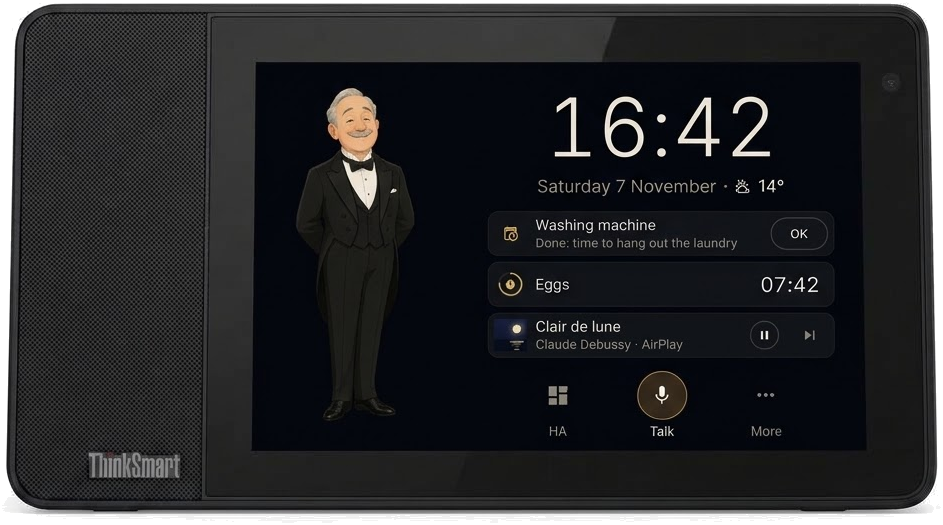</p>

[](https://github.com/m0s4ik/home-companion/releases)
[](https://www.home-assistant.io)
[](#install)
[](LICENSE)
[](https://buymeacoffee.com/m0s4ik)

If this project saved you some time, you can also
[buy me a coffee ☕](https://buymeacoffee.com/m0s4ik): it keeps the next one coming.

## What it does

### 🏠 The home screen

Alfred on a third of the screen; next to him the clock, the date and Home Assistant's weather, and one card per
thing that matters now: a due reminder, the running timers, the next alarm, the next calendar event, what AirPlay is
playing, a mirrored screen to go back to. Below: **HA**, **Talk** and **More**. A tap on the weather opens the
forecast. Settings → Screen has a compact home, with room for a fourth card.

At night Alfred sleeps: the clock stays, dimmed, with the next alarm, and a touch brings the home back for a few
seconds. By day the brightness follows the room's light. When Home Assistant does not answer, the home says so and
retries by itself; timers and alarms go on working.

<p align="center">
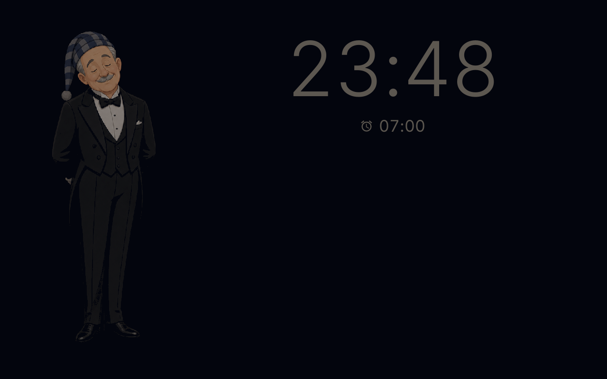 <!-- state: night -->
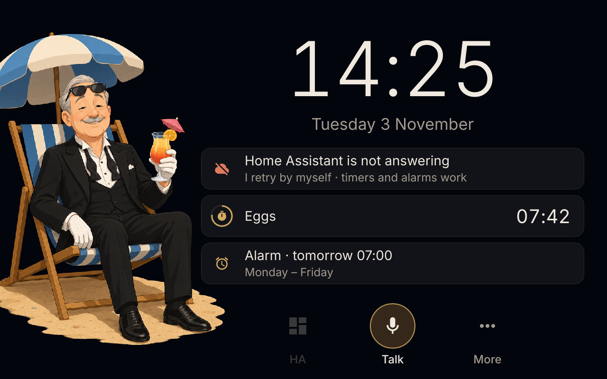 <!-- state: offline -->
</p>

### 🗣️ Talk to it

Say **"Okay Alfred"**, or tap Talk: the wake word is heard on the device, and no audio leaves it before that. Your
question goes to Home Assistant's own voice pipeline (your speech-to-text, your AI agent, your voice) and Alfred
answers on the screen and out loud. "Stop" or "basta" interrupts him; "repeat" says the last answer again; after a
question of his, a "no thanks" closes it.

If he woke up by mistake, **False alarm** next to Stop ends it and keeps that recording on the device, to train
the wake word better.

<p align="center">
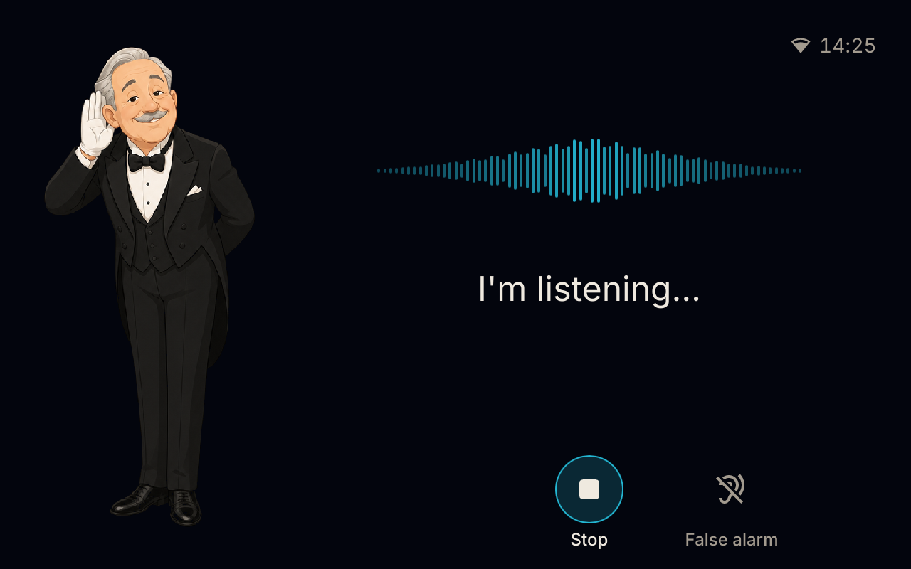 <!-- state: listening -->
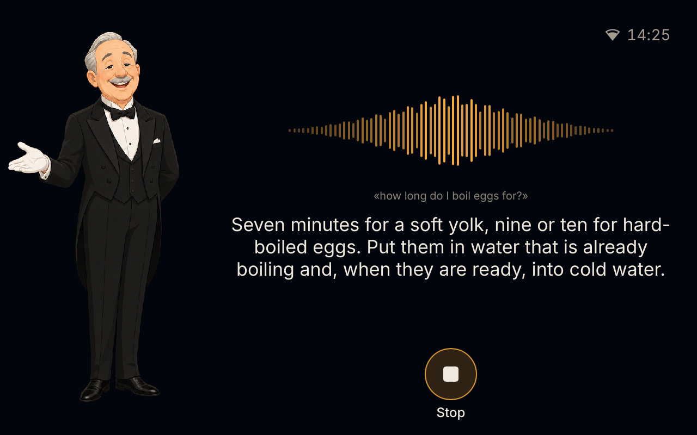 <!-- state: speaking -->
</p>

**Reflexes**: the time, timers, alarms, the volume, the music and the screen ("what time is it", "set a timer for
10 minutes", "next song", "turn off the screen") are understood **on the device** (Vosk with a closed grammar):
instant, and they work with the Wi-Fi down. Their answers are spoken in Home Assistant's voice, kept on the device
once heard. Anything else goes to Home Assistant.

**Tools for your AI**: the device lends Home Assistant's agent its own tools over HA's built-in MCP client:
memories, reminders, lists, timers and alarms, do not disturb, and the house **with safety gates**.

More → **What to say** lists examples of each kind on the screen.

### ⏱️ Timers, alarms and reminders, on the device

Timers and alarms live **on the device**: "set a pasta timer for 10 minutes", "wake me up at 7", "what timers do I
have", "how long is left for the pasta", "cancel the timer" are reflexes, understood locally and done at once, and
they ring even with the Wi-Fi or Home Assistant down. Several timers at a time, each with its name, pause and
resume, alarms on chosen days; the last ten seconds tick and a named timer says its name when it rings. Home
Assistant sees them as the satellite's timers.

Reminders come from your AI ("remind me to call mum at five"): Alfred keeps them on the device and, when one is
due, shows it full screen with a chime until you tap OK, or say "stop", or put it off ten minutes.

<p align="center">
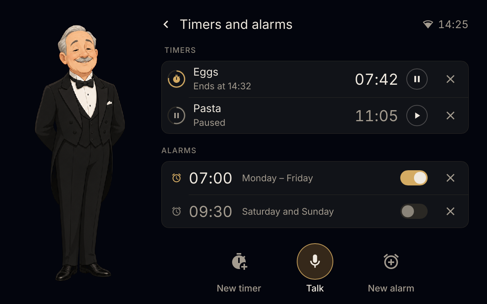 <!-- state: timers -->
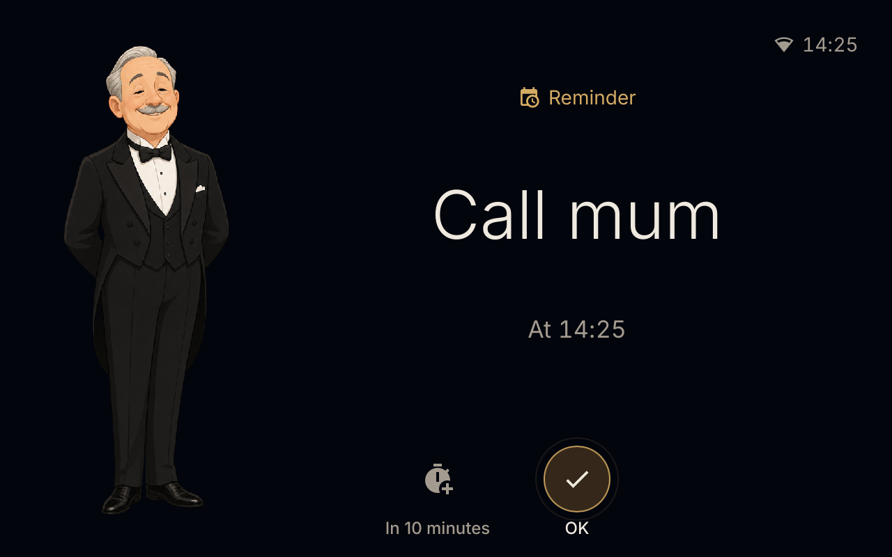 <!-- state: reminder-due -->
</p>

### 💡 The house, with a safety net

"Turn off the kitchen light", "close the living room blind to 30%": the AI uses the device's house tool, which
finds the device by its words and checks it first. Lights and switches act at once, with a card and **Undo** that puts
back what changed (a whole room at once). Covers and valves **ask first**, out loud and on the screen: answer yes
or no by voice or with a tap; after a spoken yes you have two seconds to take it back, and the same window then
says what was done, with Undo. Locks, alarms, doors and gates are never moved by voice.

<p align="center">
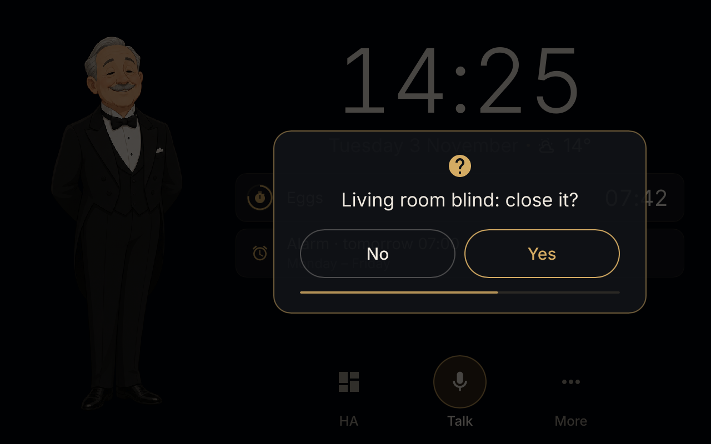 <!-- state: house-ask -->
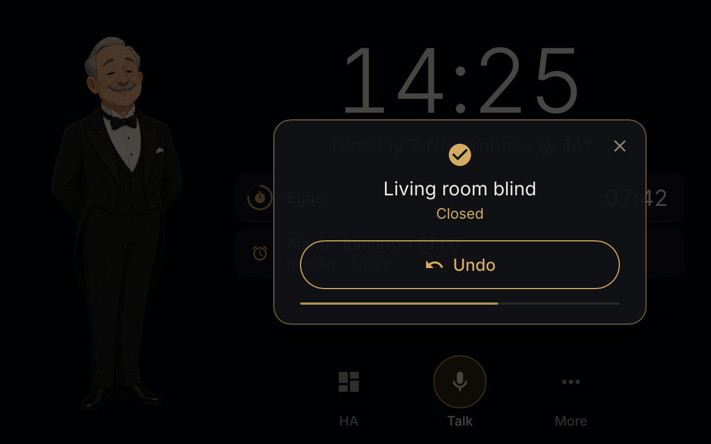 <!-- state: house-done-asked -->
</p>

### 🔕 The control centre and do not disturb

A pull from the top edge opens the control centre: Wi-Fi, AirPlay, the microphone, night mode, do not disturb and
the link to Home Assistant, each a tile that says how it stands; under them the volume, the brightness (by hand or
automatic) and what is playing.

**Do not disturb**, from its tile or by voice ("do not disturb for an hour", "good night"), silences the cards'
sounds and the announcements; timers and alarms still ring. A bell asleep on a cushion at Alfred's feet shows it
is on.

The **microphone switch** on top of the ThinkSmart View cuts the microphones in hardware; the screen shows it with
a red "Microphone off" over the clock, and the control centre's tile says who switched it off.

<p align="center">
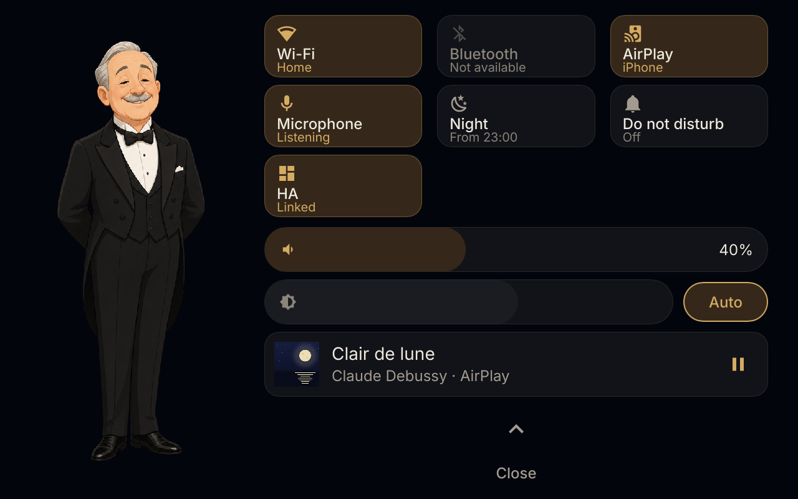 <!-- state: control-music -->
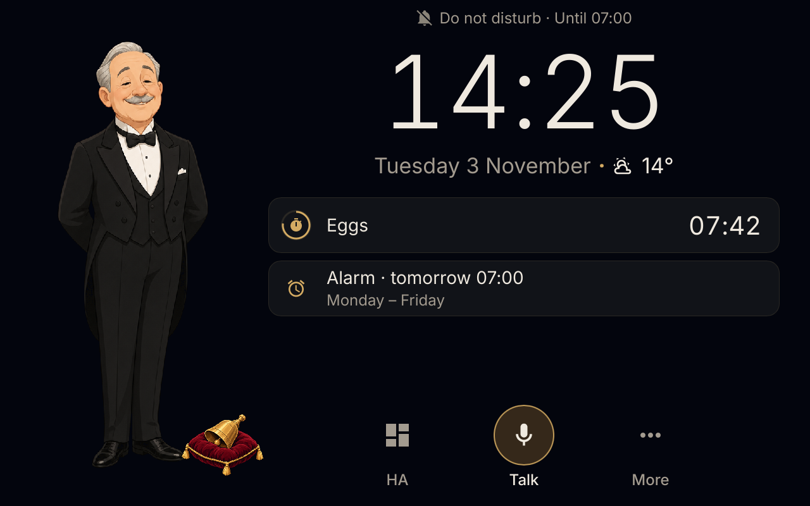 <!-- state: dnd -->
</p>

### 🧠 Memories, reminders and lists

What you tell Alfred to remember ("remember that the boiler is in the cellar") is kept **on the device** and tidied
at night; "forget that…" or one tap on More → Memories forgets a memory, another tap forgets everything. Alfred keeps
only standing facts said by you (never what was done today, nor dates), and a name he heard only once waits under
"To confirm" until you tap Right. Conversations are kept on the screen too, if you want them (Settings → Keep
conversations).

So that the assistant knows these facts at every conversation, Alfred writes them (at most 1500 characters) into Home
Assistant as the state `sensor.alfred_memory`, which his agent's instructions read. Like any state, every Home
Assistant user can see it and its history is kept for the recorder's purge period (add it to `recorder: exclude:` to
avoid that). Two devices with the same character name would share one state: give them different names. If you
edited the agent's instructions yourself, add these lines at the end:

```
What you know about this home and the people in it:
{{ state_attr('sensor.alfred_memory', 'text') or 'Nothing yet.' }}
People registered in Home Assistant: {{ states.person | map(attribute='name') | join(', ') or 'none' }}
```

Lists and calendars are Home Assistant's: "add milk to the shopping list" writes to a `todo.*` list (Home
Assistant's own, Bring!, ...), and the home's next card reads your `calendar.*` calendars. Home Assistant page →
"Lists and calendars" has a switch for each; all of them are used until you switch some off, and several lists make
a section each on the Shopping page.

### 📊 Home Assistant on the screen

Your Home Assistant dashboard full screen, kept loaded in the background so it opens at once. The gold button, or
a swipe from its edge, brings you back to Alfred; "Okay Alfred" still works over it. "Show me the front door
camera", or the name of a dashboard, opens it by voice.

<p align="center">
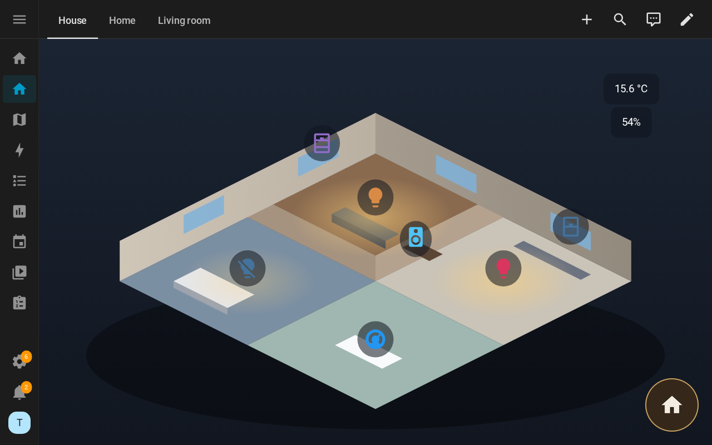
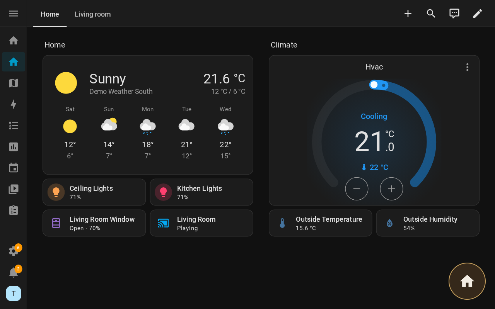
</p>
<p align="center"><sub>A test Home Assistant with its demo devices.</sub></p>

### 🎵 AirPlay: music and screen mirroring

Pick the device in the AirPlay menu of an iPhone, an iPad or a Mac. **Music** shows its cover, title and artist,
can be paused and skipped from the screen or by voice, and the phone's volume slider is the device's volume; the
music goes quiet while Alfred listens, and a gramophone plays at his feet. **Screen mirroring** uses the hardware
video decoder: upright, Alfred and the controls stay at the sides; sideways, the picture fills the screen and the
controls come with a tap.

<p align="center">
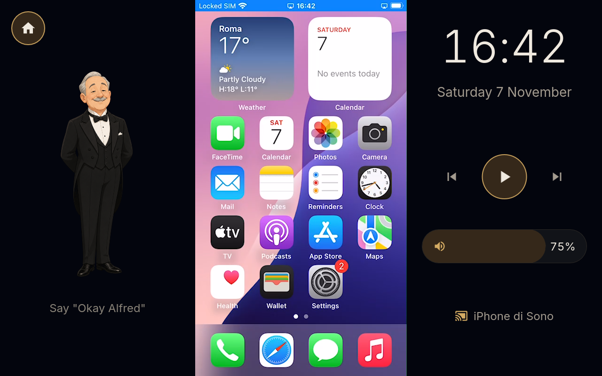 <!-- state: mirror-portrait -->
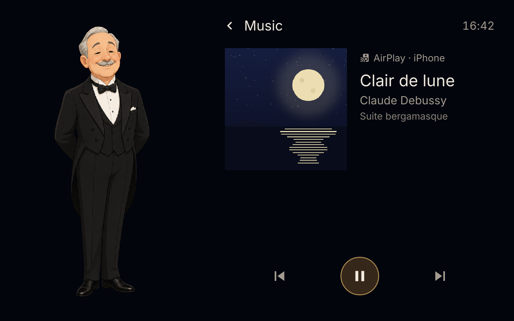 <!-- state: music -->
</p>

### 🔗 Set up from the screen

At the first start the screen asks the language, finds Home Assistant on the network and shows a QR code: open it
with a phone logged in to Home Assistant and the device sets itself up there: the Wyoming satellite, its tools
over MCP, Alfred's agent under your AI and his voice pipeline. Nothing to type, nothing to copy.

<p align="center">
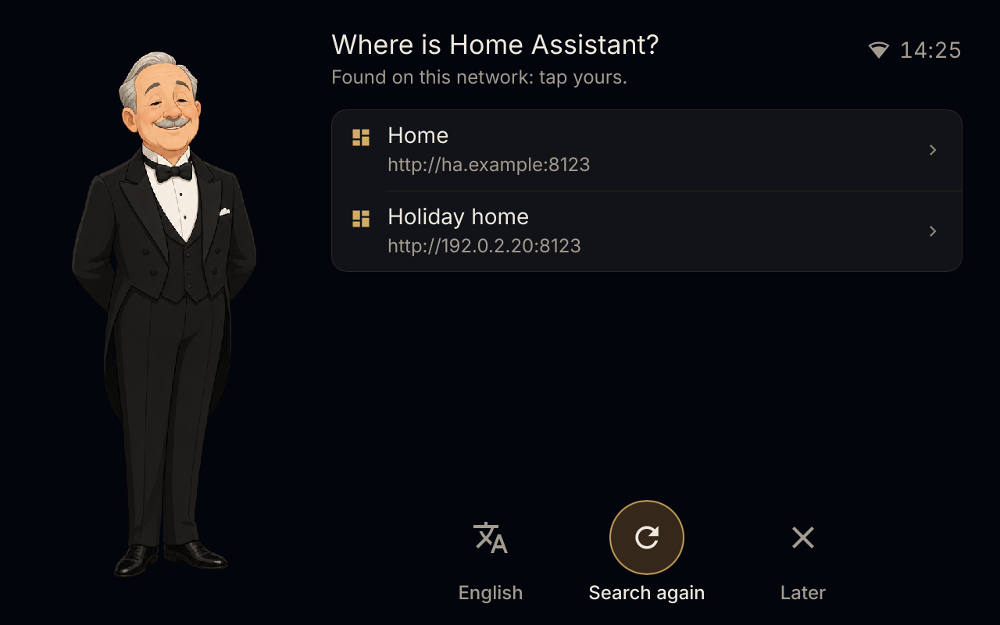 <!-- state: first-ha-found -->
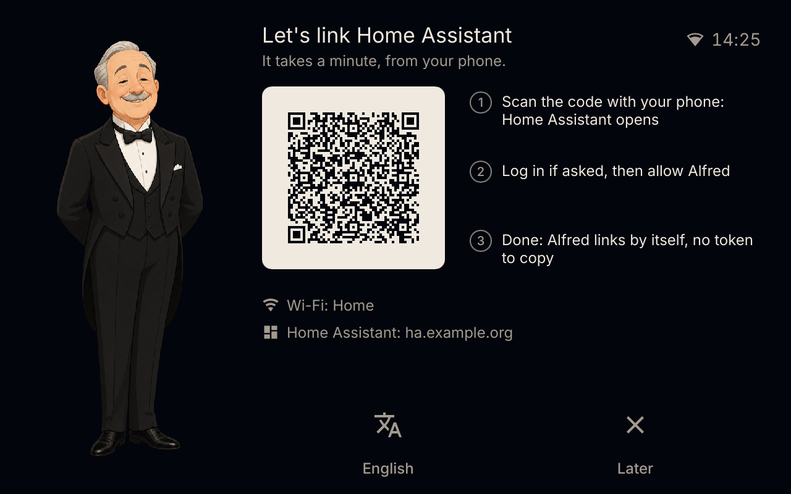 <!-- state: setup -->
</p>

### 🎛️ The Home Assistant page

More → Home Assistant is where the link is looked after. Choose the AI Alfred thinks with, the speech-to-text, the
text-to-speech and the voice among those your Home Assistant has; **Check and repair** looks at every step of the
setup again and redoes what is missing; **Unlink** takes away what the device added to Home Assistant.

**AI use** shows what the conversations cost: today, this month and the last 30 days. It is an estimate from
reference prices, or the real numbers if your AI in Home Assistant is the
[OpenAI with Token & Cost Tracking](https://github.com/m0s4ik/ha-openai-usage) integration.

<p align="center">
 <!-- state: ha -->
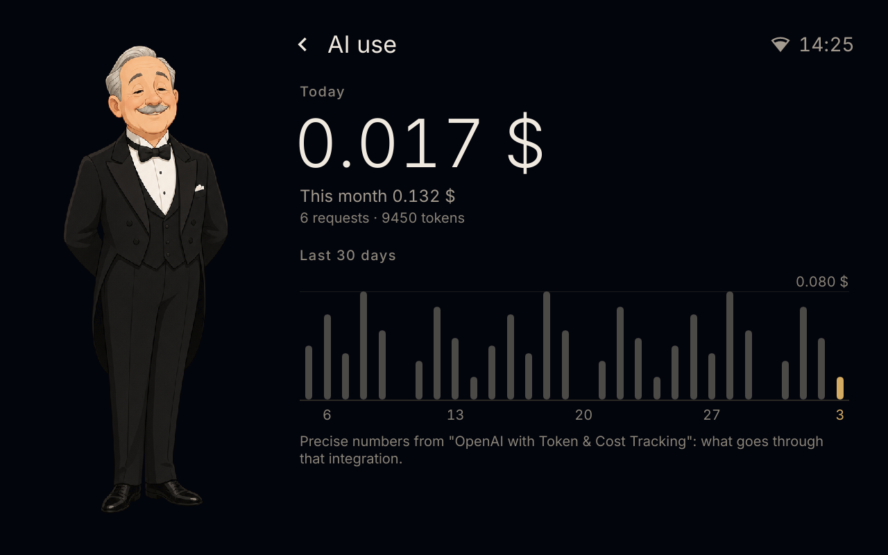 <!-- state: usage-precise -->
</p>

### 🪶 Light

Written in Rust for a 2 GB device. On the ThinkSmart View the body uses ~120 MB, the reflexes ~140 MB and the
preloaded dashboard ~450 MB, on a system that uses 190 MB by itself.

## From your automations

An automation or a script can put a card on the home screen with Home Assistant's built-in `event` action, nothing
to install:

```yaml
action: event
event: home_companion_card
event_data:
  id: washing          # optional: a card with the same id replaces the old one
  title: Laundry       # optional
  text: The washing machine is done
  icon: mdi:washing-machine   # optional
  seconds: 600         # optional: the card goes away by itself
  device: Alfred       # optional: only the device with this name (default: every device)
```

The card plays the soft reminder sound by day and goes away with its OK. `home_companion_card_dismiss` with an `id`
takes a card away.

The body fires an event too, `home_companion_conversation`, when a conversation starts and when it ends, so an
automation can make room for the voice (lower a speaker, dim a light, pause a TV):

```yaml
event_type: home_companion_conversation
event_data:
  device: Alfred          # the character's name
  state: started          # started | ended
  trigger: wake           # wake | talk (a touch) | follow_up (Alfred asked a question)
  handled_by: reflex      # only on "ended": reflex | home_assistant | none
```

`started` comes as soon as the wake word (or the touch) opens the microphone, before anything is sent to Home Assistant,
so it is there for reflexes too. Announcements do not fire it. Firing an event needs an administrator user (the one of
the QR link normally is); if Home Assistant refuses, one line in the log says so and the conversation goes on.

```yaml
automation:
  - alias: Lower the kitchen speaker while Alfred listens
    mode: single
    triggers:
      - trigger: event
        event_type: home_companion_conversation
        event_data: {state: started, device: Alfred}
    conditions:
      - condition: state
        entity_id: media_player.kitchen
        state: "playing"
    actions:
      - variables:
          before: "{{ state_attr('media_player.kitchen', 'volume_level') }}"
      - action: media_player.volume_set
        target: {entity_id: media_player.kitchen}
        data: {volume_level: 0.15}
      - wait_for_trigger:
          - trigger: event
            event_type: home_companion_conversation
            event_data: {state: ended, device: Alfred}
        timeout: "00:01:00"
        continue_on_timeout: true
      - action: media_player.volume_set
        target: {entity_id: media_player.kitchen}
        data: {volume_level: "{{ before }}"}
```

## How it works

```
 the device (home-companion)                       Home Assistant
 ┌──────────────────────────────────┐              ┌─────────────────────────────────┐
 │ wake word, reflexes, timers,     │   Wyoming    │ voice pipeline: STT → agent →   │
 │ screen, audio, AirPlay           │ ───────────▶ │ TTS (yours, e.g. Gemini)        │
 │                                  │              │                                 │
 │ home-companion-brain             │  MCP (HTTP)  │ the agent "Alfred" uses the     │
 │ memory, reminders, gates         │ ◀─────────── │ device's tools                  │
 └──────────────────────────────────┘              └─────────────────────────────────┘
```

Home Assistant does the thinking; the device is its body. Only what a normal Home Assistant installation has is
used: Wyoming, the MCP client, the WebSocket API with the token from the QR link, `ai_task`. No add-ons, no MQTT,
no second key.

Your scripts exposed to Assist work as tools. Your automations' sentence triggers still run first: Home Assistant
checks them before the AI agent whenever the request comes through the voice pipeline, even with "prefer local
intents" off. Only the answer to a follow-up question goes straight to the agent.

## Install

You need a **Lenovo ThinkSmart View with [thinksmart-view-debian](https://github.com/m0s4ik/thinksmart-view-debian)
v0.4** (v0.3-rc3 or later works), built with `WEB=1` (the Home Assistant view) and `AIRPLAY=1` (AirPlay) if you want them. The
system image is where the Wi-Fi and your ssh key are set. Then, on the device:

```sh
curl -LO https://github.com/m0s4ik/home-companion/releases/download/v0.2.0/home-companion-0.2.0-arm64.tar.gz
tar xzf home-companion-0.2.0-arm64.tar.gz
cd home-companion-0.2.0-arm64 && ./install.sh
```

The installer asks nothing: it checks the system (it never lets apt replace the image's Mesa), installs the
programs and the services, downloads the speech models of every language and starts. Then follow the screen:
language → Home Assistant (found on the network) → QR code. Options (`--language`, `--ha-url`, `--no-airplay`,
`--uninstall`, `--dry-run`…) and the manual steps are in [packaging/README.md](packaging/README.md).

**Updating** is the same three lines with the new version: an installed one is updated in place and its settings
stay.

To change the Wi-Fi later: `nmcli device wifi connect "<ssid>" password "<password>"` on the device.

## Languages

Italian, English, Dutch and German, complete: the screen (`locales/`), the reflexes' grammar
(`characters/alfred/grammar/`) and the speech model the installer downloads. With any other language set in Home
Assistant, the device still works (Home Assistant answers in its language) without the local reflexes.

Adding a language: a `locales/<lang>.toml`, a `characters/alfred/grammar/<lang>.toml`, the number words in
`crates/reflex/src/slots.rs`, and the [Vosk model](https://alphacephei.com/vosk/models) in the installer's
`VOSK_MODELS` table (and `--language`). For the character and Home Assistant: `[phrases.<lang>]` and
`persona.<lang>.md` in `characters/alfred/`, `crates/home-companion/src/ha/agent-prompt.<lang>.md` with its line in
`agent_prompt()` and the OpenAI hints in `speech_hints()` (both in `ha/setup.rs`); the brain's own words (yes/no
questions, the morning summary's fallback) in `Lang` of `crates/brain/src/house.rs`.

## Build from source

Cross-compiled from an amd64 Debian 13 with the arm64 multiarch libraries:

```sh
cargo build --release --target aarch64-unknown-linux-gnu -p home-companion --no-default-features --features fbdev,gpu
cargo run -p home-companion -- --simulator          # the screen in a window on a laptop
tools/release/build-bundle.sh 0.2.0                 # the release bundle
```

Contributing, with or without a coding assistant: [AGENTS.md](AGENTS.md).
The design: [docs/design.md](docs/design.md) and the screen: [docs/ui.md](docs/ui.md).

## Licences and credits

- **home-companion**: GPL-3.0-or-later ([LICENSE](LICENSE)). The character Alfred (pictures, phrases, sounds):
  CC0-1.0 ([characters/alfred](characters/alfred)).
- Third parties, all listed in the release bundle's `THIRD-PARTY.md`: [UxPlay](https://github.com/FDH2/UxPlay)
  (GPL-3.0, patched: `tools/airplay/`), [femtovg](https://github.com/femtovg/femtovg) (MIT/Apache-2.0, patched:
  `third_party/`), [Slint](https://slint.dev) (GPL-3.0), [Vosk](https://alphacephei.com/vosk) (Apache-2.0),
  TensorFlow Lite Micro (Apache-2.0).
- Wake word "Okay Alfred": [Tater Totterson](https://github.com/TaterTotterson/Tater-Wake-Words) (MIT); "stop":
  ESPHome's (Apache-2.0).
- ⚠️ The stop words **"basta" and "stop_alfred"** were trained here on synthetic speech that includes some
  [Piper](https://github.com/rhasspy/piper) voices whose datasets allow **non-commercial use only**. Fine for a
  personal device; if you build something commercial, retrain them (see
  [characters/alfred/stopword/README.md](characters/alfred/stopword/README.md)).

An independent project, not affiliated with Home Assistant or Lenovo; ThinkSmart is a trademark of its owner.
